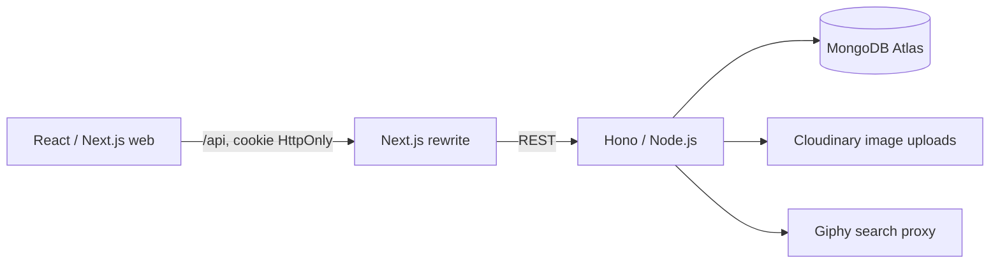

# Tellme — Kiến trúc đang triển khai

Web React đã nối với API thật. Theo cấu hình chủ dự án cung cấp ngày 29/10/2026, backend dùng **MongoDB Atlas và Cloudinary**, thay cho PostgreSQL/Drizzle và R2 trong định hướng cũ. [Bản kiến trúc ban đầu](docs/references/architecture-original.md) được giữ làm tài liệu lịch sử, không mô tả runtime hiện tại.

## Các phần đang hoạt động

| Phần | Triển khai |
| --- | --- |
| Web | Next.js 15 App Router, React, Tailwind CSS v4, TanStack Query, React Hook Form, Zod, Zustand |
| API | Hono trên Node.js, TypeScript; `tsx watch` khi phát triển, JavaScript biên dịch khi chạy production |
| Database | MongoDB Node driver; UUID string; index email/username, bài viết theo thời gian/tác giả, ngày ảnh, hội thoại/thông báo, TTL session |
| Đăng nhập | Email/mật khẩu, scrypt có salt, session ngẫu nhiên; chỉ hash token lưu trong MongoDB; cookie HttpOnly/SameSite=Lax; Secure khi production |
| Ảnh | Upload multipart tối đa 50 MB; nhận JPEG/PNG/HEIC/HEIF/WebP/GIF/AVIF/BMP/TIFF theo chữ ký file; giữ kích thước/tỷ lệ ảnh gốc, Cloudinary phân phối định dạng phù hợp trình duyệt; feed dùng bản xem trước, avatar/cover căn cắt tại thiết bị trước khi upload |
| GIF / sticker | API proxy Giphy; khóa chỉ ở backend; bình luận chỉ nhận HTTPS thuộc Giphy |
| Cập nhật tin nhắn / thông báo | TanStack Query polling; chưa dùng WebSocket |

## Ranh giới mã nguồn

- `apps/web/src/app/`: route `/auth`, `/community`, `/post`; không có nghiệp vụ database.
- `apps/web/src/lib/api-repository.ts`: gọi REST, cache metadata và các trang nội dung đã tải; chuyển thao tác draft của component thành các lệnh REST riêng. Không gửi cả state trình duyệt để ghi vào DB.
- `apps/web/src/hooks/use-community.ts`: metadata tài khoản, mutation và invalidation; `use-posts.ts`: phân trang feed/hồ sơ.
- `apps/api/src/main.ts`: kết nối/index DB trước khi nhận request; bind loopback; đóng connection khi shutdown.
- `apps/api/src/backend/`: cấu hình môi trường, Mongo collections/models, session/security, Zod, quyền truy cập và DTO.
- `apps/api/src/modules/`: route thật theo auth, bootstrap, user, post, story, message, notification, media. Các controller/service/repository rỗng ban đầu đã được thay thế.
- `packages/database/`: scaffold PostgreSQL/Drizzle của định hướng cũ, **không được API hiện tại import**. Mobile, admin và workers vẫn là scaffold; chưa nối vào backend mới.

## Dữ liệu và quyền

Collections: `users`, `sessions`, `posts`, `stories`, `conversations`, `messages`, `notifications`, `media`, `reports`.

API lấy actor từ session, bỏ qua actor/timestamp/count do client tự khai. Chỉ chủ bài được xóa bài và chỉ chủ tài khoản được sửa hồ sơ. Quyền xem áp dụng ở server trước khi trả feed, chi tiết, dòng thời gian hay chia sẻ bài vào chat. Chặn áp dụng hai chiều. Đối tượng `connections` hiện nghĩa là hai tài khoản follow lẫn nhau; follow một chiều không tự mở quyền này. Bài ẩn danh trả author `anonymous` cho người khác; tên/email/hash mật khẩu không được nhúng vào DTO bài ẩn danh.

Trong DTO dành cho web, tài khoản hiện tại có alias `me`; DB luôn lưu UUID thật. API không nhận alias này làm bằng chứng danh tính. Chat kiểm tra thành viên ở mọi thao tác đọc/gửi; bài đính kèm phải hiển thị được cho các thành viên nhận.

Feed/hồ sơ lấy từng trang 6 mục theo thời gian; MongoDB xử lý lọc, sắp xếp, skip/limit và merge bài viết với ngày ảnh. Web chỉ yêu cầu trang tiếp khi sentinel gần viewport. Metadata không tải toàn bộ feed. Bootstrap giới hạn 500 hồ sơ gần đây, 100 chuỗi ảnh/hội thoại/thông báo, 50 tin mới nhất mỗi hội thoại. API có endpoint lấy lịch sử chat cũ; đây chưa phải hệ thống tìm kiếm/phân phối feed cho quy mô lớn.

## Môi trường và vận hành

Khóa thật đặt trong `apps/api/.env.local` (Git ignore, quyền file 0600). File ví dụ chứa placeholder. Next dùng `API_INTERNAL_URL` cho rewrite phía server; không có MongoDB/Cloudinary secret trong biến `NEXT_PUBLIC_*`. Origin ghi dữ liệu phải nằm trong `WEB_ORIGINS`. Có giới hạn kích thước body và rate limit trong bộ nhớ một process; lỗi driver không trả connection string cho trình duyệt.

Hướng dẫn chạy và API: [BACKEND.md](docs/BACKEND.md). Nhận diện: [DESIGN.md](docs/DESIGN.md). Sản phẩm: [PRODUCT.md](docs/PRODUCT.md). Frontend: [FRONTEND.md](docs/FRONTEND.md).

## Phạm vi tiếp theo

Chưa triển khai email xác minh/reset mật khẩu, OAuth, push/email, WebSocket, dashboard xử lý báo cáo, Redis/queue, backup/monitoring và triển khai public HTTPS. Trước khi chạy nhiều instance cần rate limit tập trung, chiến lược phân trang ổn định bằng cursor và tối ưu truy vấn/giới hạn collection. Đây là backend thật cho các luồng cốt lõi đã kiểm thử, không phải tuyên bố toàn bộ hạ tầng production đã hoàn tất.
