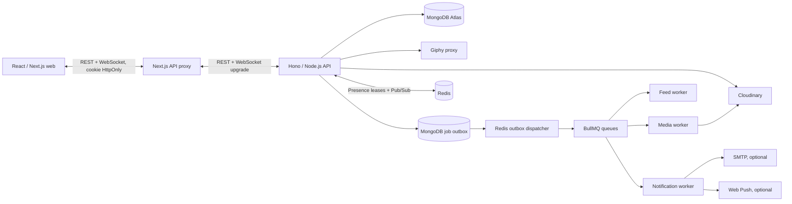

# Tellme — Kiến trúc đang triển khai

Tellme là mạng xã hội để kể chuyện và lưu những khoảnh khắc thường ngày. Web dùng React; backend lưu dữ liệu thật trong MongoDB, lưu ảnh trên Cloudinary và xử lý tác vụ nền qua MongoDB outbox + Redis/BullMQ. Mobile chưa nằm trong phạm vi runtime này.

## Các ứng dụng

| Phần | Runtime |
| --- | --- |
| `apps/web` | Next.js App Router, React, Tailwind CSS, TanStack Query, React Hook Form, Zod và Zustand. `/community/today` và `/community/feed` cho phép khách xem nội dung công khai; tương tác ghi dữ liệu cần đăng nhập. |
| `apps/api` | Hono/Node.js, REST JSON, cookie session HttpOnly, Zod validation, kiểm tra ownership, privacy và block tại server. Guest chỉ được gọi các route đọc công khai. |
| `packages/database` | MongoDB collections/indexes, config gốc, Cloudinary media lifecycle, Redis/BullMQ outbox, feed cache và thông báo. |
| `workers/media-processor` | Tạo thumbnail, ảnh feed và blurhash; dọn ảnh Cloudinary mồ côi. |
| `workers/feed-builder` | Làm mới cache feed công khai và chủ đề thịnh hành. |
| `workers/notification-sender` | Ghi thông báo, gửi email qua SMTP và push qua VAPID khi các dịch vụ đó được cấu hình. |
| `apps/admin` | React/Vite: tổng quan, hạ tầng, log server, tác vụ nền, người dùng, kiểm duyệt nội dung/báo cáo, thống kê sử dụng và nhật ký quản trị. API giới hạn email quản trị đã xác thực trong `ADMIN_EMAILS`; thay đổi dữ liệu và nhật ký cùng transaction. Xem [ADMIN.md](docs/ADMIN.md). |
| `apps/mobile` | Ngoài phạm vi, chưa kết nối backend này. |

Các khóa cấu hình nằm trong một `.env` ở gốc workspace; `.env.example` chỉ chứa giá trị mẫu. `pnpm dev` đọc cấu hình gốc, khởi động Redis bằng Docker Compose nếu Redis cục bộ chưa chạy, rồi chạy các workspace có tác vụ phát triển.

## Lưu trữ và an toàn dữ liệu

MongoDB giữ `users`, `sessions`, `posts`, `stories`, `conversations`, `messages`, `notifications`, `media`, `reports`, `background_jobs` và `push_subscriptions`. Session dùng token ngẫu nhiên; DB chỉ lưu SHA-256 token. Mật khẩu dùng scrypt. Guest nhận DTO công khai; email và password hash bị loại khỏi truy vấn bootstrap.

API là nguồn xác thực cuối cùng cho người đăng, ownership, privacy, quyền follow hai chiều, chặn, người nhận chat và nội dung đính kèm. Client gửi lệnh REST hẹp, không ghi đè toàn bộ state. Session cookie không được cất trong localStorage.

Ảnh upload tối đa 50 MB. API kiểm tra chữ ký nội dung, không tin MIME từ trình duyệt; ảnh được gắn chủ sở hữu trước khi URL có thể dùng trong bài, chuỗi ảnh hoặc hồ sơ. Khi nội dung bị xóa hoặc ảnh hồ sơ được thay, transaction ghi job cleanup vào outbox. Worker chỉ xóa Cloudinary object sau khi xác nhận không còn bài, chuỗi hay hồ sơ nào tham chiếu URL đó. Sweeper kiểm tra lại media cũ để phục hồi dọn dẹp bị gián đoạn.

## Tác vụ nền và realtime

MongoDB outbox là nguồn bền vững cho job. Dispatcher đưa tác vụ vào BullMQ/Redis; worker xử lý retry/backoff rồi lưu kết quả cuối cùng. Job lỗi có thể tra cứu và retry qua API admin. Khi Redis tạm ngừng, API tiếp tục lưu outbox; worker tiếp tục sau khi Redis trở lại. WebSocket `/api/realtime` dùng chung cho chat và presence. Khi Redis không sẵn sàng, web giữ polling dự phòng và ẩn trạng thái hoạt động chưa xác nhận.

Feed worker cache danh sách public IDs và chủ đề thịnh hành. API dùng cache cho khách; trước khi trả dữ liệu vẫn truy vấn lại quyền public. Cập nhật trong ứng dụng đi qua Redis Pub/Sub rồi WebSocket có giới hạn theo user; browser nhận sự kiện để làm mới query. Heartbeat `h`/`p` nằm trên chính socket này, không tạo HTTP request hoặc ghi MongoDB. Redis giữ lease từng kết nối 75 giây; chỉ chuyển online/offline mới publish và chỉ bạn bè hai chiều được nhận. `/api/events` SSE được giữ cho client cũ.

Thông báo trong ứng dụng hoạt động mặc định. Email chỉ bật khi đặt `SMTP_URL`; web push chỉ bật khi đặt cả VAPID public/private keys. Email và push không giả lập thành công nếu thiếu cấu hình. Push endpoint được giới hạn ở nhà cung cấp browser hợp lệ và thuộc tài khoản đăng nhập.

## Vận hành

Chạy tại gốc workspace bằng `pnpm install` rồi `pnpm dev`. Redis local cần Docker Desktop; có thể chạy riêng bằng `pnpm infra:up`. API mặc định cổng 4000, web 3000, admin 3001. Build workspace bằng `pnpm build`, kiểm tra TypeScript bằng `pnpm check-types`. Compose phát triển ở `infra/docker/docker-compose.yml` chỉ chạy Redis. Compose production cho Coolify tại `infra/deploy/compose.yaml` ghép web, landing, admin, API, workers và Redis, kết nối tới MongoDB Atlas hiện tại qua `MONGODB_URI`, rồi reverse proxy ba domain; xem [hướng dẫn deploy](infra/deploy/README.md).

Hướng dẫn API, biến môi trường và xử lý dữ liệu nằm trong [docs/BACKEND.md](docs/BACKEND.md). Web nằm trong [docs/FRONTEND.md](docs/FRONTEND.md). Bản PostgreSQL/Drizzle/R2 ban đầu được giữ trong [docs/references/architecture-original.md](docs/references/architecture-original.md) làm tài liệu lịch sử, không phải runtime hiện tại.

Backend đã bao phủ các luồng web cốt lõi và worker, nhưng trước triển khai công khai vẫn cần bật dịch vụ Redis/MongoDB, thiết lập backup/monitoring và điền các nhà cung cấp email/push nếu muốn dùng chúng.

## Nhạc theo ngày

Chuỗi `stories` có một bài nhạc chung ở trường `music`; ảnh tiếp theo tự dùng cùng lựa chọn. Web cho người dùng chọn kho YouTube Data API v3 hoặc Epidemic Sound trước khi tìm; kho đã chọn quyết định provider lưu. YouTube lọc quyền nhúng/khu vực VN tại server trước khi hiển thị. Mỗi chuỗi lưu thêm mốc bắt đầu phát chung. API client cũ không chọn nguồn vẫn giữ dự phòng tự động. Key chỉ ở `.env` gốc; video YouTube phát bằng iframe chính thức hiển thị rõ. Bài đã chọn giữ đúng provider; Epidemic Sound Developer Free vẫn chỉ dành cho prototype, bị khóa trên production. Luồng, API và phạm vi giấy phép: [docs/MUSIC.md](docs/MUSIC.md).
