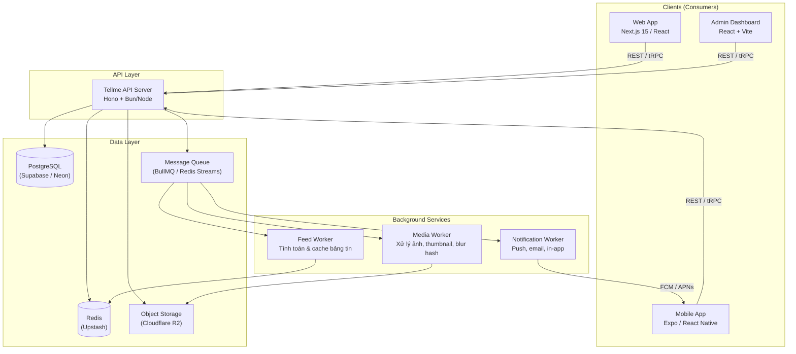
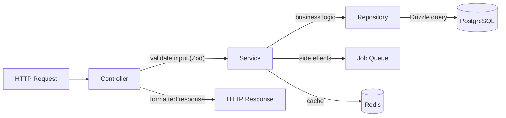
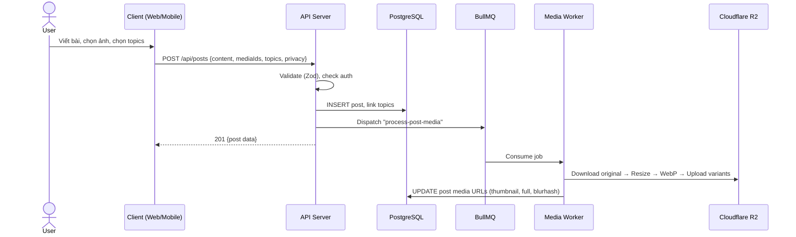
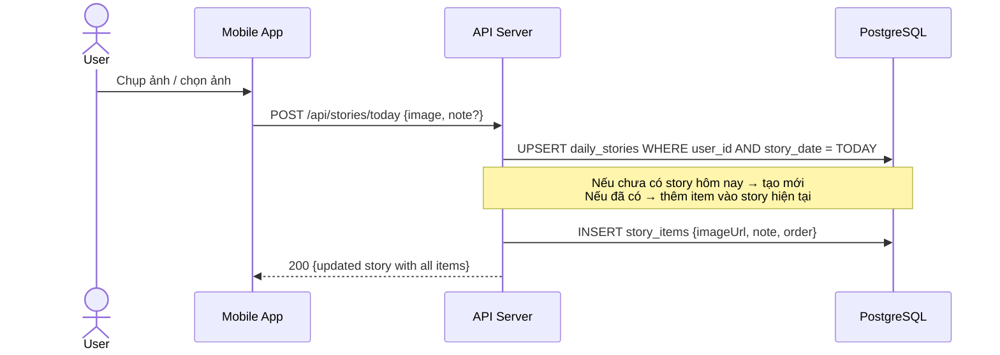
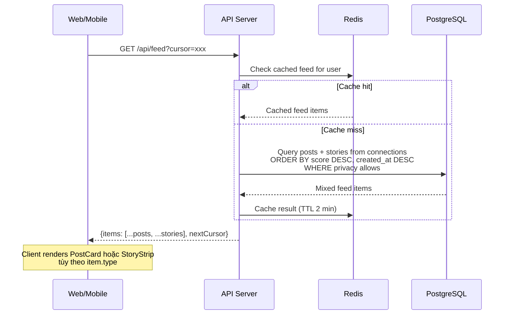
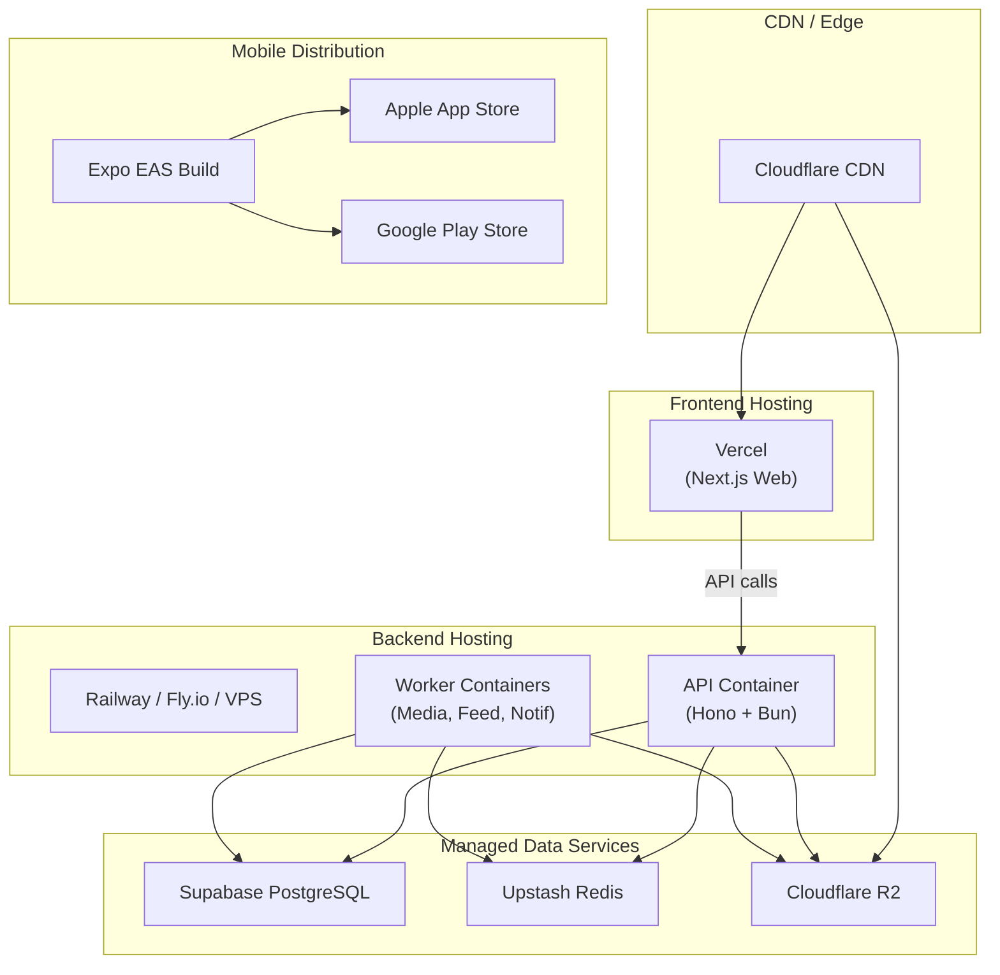

> Tài liệu định hướng ban đầu, được giữ để tham khảo. Stack backend đang chạy xem ARCHITECTURE.md ở gốc project.

# Tellme — System Architecture & Project Structure

> **Trạng thái tài liệu:** Bản kiến trúc chính của project. Mô tả sản phẩm xem [docs/PRODUCT.md](docs/PRODUCT.md), quy ước thư mục xem [docs/STRUCTURE.md](docs/STRUCTURE.md), nhận diện xem [docs/DESIGN.md](docs/DESIGN.md).
>
> Frontend web đã được triển khai với dữ liệu mẫu, theo yêu cầu mới của chủ dự án; xem [docs/FRONTEND.md](docs/FRONTEND.md) để biết các luồng hiện có và giới hạn. Backend, workers và mobile chưa được phát triển thêm. Các ví dụ backend, lựa chọn công nghệ và mô hình dữ liệu bên dưới vẫn là định hướng triển khai; phiên bản thực tế nằm trong từng `package.json`. Các ước tính hiệu năng, gói dịch vụ và chi phí trong tài liệu gốc chưa được xác minh lại.

> **Nguyên tắc thiết kế kiến trúc:**
> Frontend là Frontend, Backend là Backend, Database là Database — mỗi layer triển khai độc lập, scale độc lập, maintain độc lập.

---

## 1. Tổng quan Kiến trúc



### Tại sao tách như vậy?

| Quyết định | Lý do |
| :--- | :--- |
| **API Server tách riêng** | Web, Mobile, Admin đều gọi chung 1 API. Thay đổi business logic chỉ sửa 1 nơi. Deploy backend không ảnh hưởng frontend và ngược lại. |
| **Background Workers tách riêng** | Xử lý ảnh nặng (resize, WebP, blur hash) không được chặn API response. Feed tính toán phức tạp chạy bất đồng bộ. |
| **Một database PostgreSQL duy nhất** | Dữ liệu của Tellme quan hệ chặt với nhau: feed phải join theo connections, comment/reaction đếm theo post, report trỏ tới nhiều loại entity. Postgres xử lý JOIN + ràng buộc toàn vẹn (FK, unique) tốt hơn nhiều so với tách sang NoSQL rồi tự ghép dữ liệu ở application layer. Cột `jsonb` vẫn cho phép lưu field linh hoạt (metadata tin nhắn, privacy_settings) khi cần, không phải đánh đổi khả năng join để lấy sự linh hoạt. |
| **Database layer dùng chung package** | Schema, migration, type definitions dùng chung giữa API và Workers (`packages/database`), đảm bảo nhất quán. |
| **Shared packages (validators, types, UI)** | Validation (Zod), types, constants, và design tokens dùng chung; Web/Admin dùng component DOM, Mobile có component React Native riêng — tránh duplicate code, đảm bảo type-safety end-to-end. |

---

## 2. Tech Stack Chi Tiết

### 2.1 Backend — API Server

| Thành phần | Công nghệ | Lý do chọn |
| :--- | :--- | :--- |
| **Runtime** | **Bun** (fallback Node.js 22) | Nhanh gấp 3-4x Node ở IO-heavy tasks. Native TypeScript, không cần transpile. |
| **Framework** | **Hono** | Lightweight (~14KB), TypeScript-first, middleware ecosystem tốt, chạy được trên Bun/Node/Edge. Không bị lock-in vào runtime nào. |
| **Validation** | **Zod** | Schema validation dùng chung với frontend. Type inference tự động. |
| **Database** | **PostgreSQL** (Supabase / Neon) | 1 database duy nhất cho toàn bộ hệ thống — user, post, story, message, notification... Quan hệ chặt, cần join và transaction thường xuyên. |
| **ORM** | **Drizzle ORM** | Type-safe, SQL-first (không abstract quá mức), migration tự động, hiệu năng cao hơn Prisma. Dùng `jsonb` cho các field cần linh hoạt (metadata tin nhắn, privacy_settings) thay vì tách sang NoSQL riêng. |
| **Auth** | **Better Auth** hoặc **Lucia Auth** | Lightweight, không phụ thuộc dịch vụ bên ngoài, hỗ trợ OAuth (Google, Apple), session-based. |
| **Realtime** | **Socket.io** hoặc **Hono WebSocket** | Chat 1-1, chat nhóm, thông báo real-time, cập nhật "Chuyện hôm nay". |
| **Queue** | **BullMQ** (chạy trên Redis) | Background jobs: xử lý ảnh, gửi notification, build feed. Retry, scheduling, rate limiting built-in. |
| **Cache** | **Redis** (Upstash cho serverless) | Cache feed, session, rate limiting, trending topics, online status. |
| **Storage** | **Cloudflare R2** | S3-compatible, **zero egress fee** (không tốn tiền bandwidth tải ảnh — cực quan trọng với app ảnh). |
| **Image processing** | **Sharp** | Resize, chuyển WebP/AVIF, tạo blur hash placeholder. Chạy trong Media Worker. |

### 2.2 Frontend — Web App

| Thành phần | Công nghệ | Lý do chọn |
| :--- | :--- | :--- |
| **Framework** | **Next.js 15** (App Router) | SSR khi share link bài viết ra Facebook/Zalo (OG tags, SEO). Static generation cho các trang công khai. |
| **Data fetching** | **TanStack Query (React Query)** | Quản lý dữ liệu lấy từ API, trạng thái loading/error, cache, dedup, optimistic updates, infinite scroll cho feed, refetch khi focus lại tab. |
| **API Client** | **Axios** hoặc **ky** + Generated types | Gọi đến API Server riêng biệt. Không dùng Server Actions cho business logic. |
| **State** | **Zustand** | Lightweight, không boilerplate. Chỉ dùng khi thật sự cần state UI dùng chung (modal, sidebar, theme) — state của server luôn để TanStack Query quản lý, tránh trùng lặp nguồn sự thật. |
| **Styling** | **Tailwind CSS v4** + Design Tokens (`packages/ui`) | Nền tảng để xây hệ thống kiểu dáng nhất quán xuyên suốt Web/Mobile/Admin — spacing, màu, typography đều lấy từ 1 bộ token duy nhất. |
| **Components** | **Bộ component riêng của Tellme (`packages/ui`)** | Thiết kế riêng cho Tellme thay vì phụ thuộc hoàn toàn vào 1 UI kit có sẵn — tránh "nhìn giống mọi app khác dùng cùng 1 theme mặc định", đồng thời vẫn dùng Radix UI (unstyled, accessible) làm nền cho các phần phức tạp (dropdown, dialog, popover) rồi style lại 100% bằng token của Tellme. |
| **Forms** | **React Hook Form** + **Zod** resolver | Validation dùng chung Zod schema với backend. |

### 2.3 Frontend — Mobile App

| Thành phần | Công nghệ | Lý do chọn |
| :--- | :--- | :--- |
| **Framework** | **Expo SDK 53+** (Expo Router) | File-based routing, OTA updates, EAS Build/Submit lên Store. |
| **Navigation** | **Expo Router** (React Navigation dưới hood) | Deep linking, tab navigation, stack navigation. |
| **Data fetching** | **TanStack Query** | Cùng cấu hình/hook với Web, dùng chung logic qua `packages/shared` — chỉ khác tầng storage cache (AsyncStorage thay vì browser cache). |
| **State** | **Zustand** | Dùng chung store pattern với Web cho state UI (ví dụ: trạng thái camera, draft story chưa đăng). |
| **Camera** | **expo-camera** + **expo-image-picker** | Chụp ảnh "Chuyện hôm nay", chọn ảnh từ thư viện. |
| **Notifications** | **expo-notifications** + FCM/APNs | Push notification khi có tương tác, tin nhắn mới. |
| **Styling** | **NativeWind** (Tailwind cho React Native) | Dùng chung class names và token với Web (`packages/ui/tokens`), giảm context-switching. |
| **Components** | **Bộ component riêng của Tellme**, dựng lại bằng NativeWind từ cùng token/spec với Web — không kéo nguyên 1 UI kit React Native có sẵn vào. |
| **Storage** | **expo-secure-store** | Lưu auth token an toàn. |


---

## 3. Cấu Trúc Thư Mục (Monorepo — Turborepo)

```
tellme/
│
├── apps/                                 # ← Các ứng dụng chạy độc lập
│   │
│   ├── api/                              # ═══ BACKEND API SERVER ═══
│   │   ├── src/
│   │   │   ├── modules/                  #   Business logic, chia theo domain
│   │   │   │   ├── auth/
│   │   │   │   │   ├── auth.controller.ts    # Route handlers (HTTP layer)
│   │   │   │   │   ├── auth.service.ts       # Business logic (core)
│   │   │   │   │   ├── auth.repository.ts    # Database queries (data layer)
│   │   │   │   │   └── auth.test.ts
│   │   │   │   ├── user/
│   │   │   │   │   ├── user.controller.ts
│   │   │   │   │   ├── user.service.ts
│   │   │   │   │   ├── user.repository.ts
│   │   │   │   │   └── user.test.ts
│   │   │   │   ├── post/
│   │   │   │   │   ├── post.controller.ts
│   │   │   │   │   ├── post.service.ts
│   │   │   │   │   ├── post.repository.ts
│   │   │   │   │   └── post.test.ts
│   │   │   │   ├── topic/
│   │   │   │   │   ├── topic.controller.ts
│   │   │   │   │   ├── topic.service.ts
│   │   │   │   │   └── topic.repository.ts
│   │   │   │   ├── story/                    # "Chuyện hôm nay"
│   │   │   │   │   ├── story.controller.ts
│   │   │   │   │   ├── story.service.ts
│   │   │   │   │   └── story.repository.ts
│   │   │   │   ├── connection/               # Kết bạn, follow
│   │   │   │   │   ├── connection.controller.ts
│   │   │   │   │   ├── connection.service.ts
│   │   │   │   │   └── connection.repository.ts
│   │   │   │   ├── message/                  # Chat 1-1, nhóm
│   │   │   │   │   ├── message.controller.ts
│   │   │   │   │   ├── message.service.ts
│   │   │   │   │   ├── message.gateway.ts    # WebSocket handler
│   │   │   │   │   └── message.repository.ts
│   │   │   │   ├── notification/
│   │   │   │   │   ├── notification.controller.ts
│   │   │   │   │   ├── notification.service.ts
│   │   │   │   │   └── notification.repository.ts
│   │   │   │   ├── media/                    # Upload, presigned URLs
│   │   │   │   │   ├── media.controller.ts
│   │   │   │   │   ├── media.service.ts
│   │   │   │   │   └── media.repository.ts
│   │   │   │   ├── feed/                     # Bảng tin tổng hợp
│   │   │   │   │   ├── feed.controller.ts
│   │   │   │   │   └── feed.service.ts
│   │   │   │   ├── explore/                  # Khám phá, trending
│   │   │   │   │   ├── explore.controller.ts
│   │   │   │   │   └── explore.service.ts
│   │   │   │   └── moderation/               # Báo cáo, chặn, kiểm duyệt
│   │   │   │       ├── moderation.controller.ts
│   │   │   │       ├── moderation.service.ts
│   │   │   │       └── moderation.repository.ts
│   │   │   │
│   │   │   ├── common/                   #   Shared logic cho API
│   │   │   │   ├── middleware/
│   │   │   │   │   ├── auth.middleware.ts         # Xác thực JWT/Session
│   │   │   │   │   ├── rate-limit.middleware.ts
│   │   │   │   │   └── error-handler.middleware.ts
│   │   │   │   ├── guards/
│   │   │   │   │   ├── privacy.guard.ts          # Kiểm tra quyền xem nội dung
│   │   │   │   │   └── ownership.guard.ts        # Chỉ chủ sở hữu mới sửa/xóa
│   │   │   │   └── utils/
│   │   │   │       ├── pagination.ts             # Cursor-based pagination helper
│   │   │   │       └── response.ts               # Chuẩn hóa API response
│   │   │   │
│   │   │   ├── infra/                    #   Kết nối hạ tầng bên ngoài
│   │   │   │   ├── database.ts               # Drizzle client, connection pool
│   │   │   │   ├── redis.ts                  # Redis client
│   │   │   │   ├── storage.ts                # R2/S3 client
│   │   │   │   ├── queue.ts                  # BullMQ connection
│   │   │   │   └── websocket.ts              # Socket.io server setup
│   │   │   │
│   │   │   ├── app.ts                    #   Hono app setup, mount routes
│   │   │   └── main.ts                   #   Entry point, start server
│   │   │
│   │   ├── .env.example
│   │   ├── Dockerfile
│   │   ├── tsconfig.json
│   │   └── package.json
│   │
│   ├── web/                              # ═══ FRONTEND WEB (Next.js) ═══
│   │   ├── src/
│   │   │   ├── app/                      #   App Router: chỉ route và layout
│   │   │   │   ├── auth/                 #     URL /auth/login và /auth/register
│   │   │   │   │   ├── login/page.tsx
│   │   │   │   │   └── register/page.tsx
│   │   │   │   ├── community/            #     URL có tiền tố /community
│   │   │   │   │   ├── layout.tsx        #       Shell hiện có; chưa có auth guard
│   │   │   │   │   ├── feed/page.tsx
│   │   │   │   │   ├── explore/page.tsx
│   │   │   │   │   ├── today/page.tsx    #       Chuyện hôm nay / Daily Moments
│   │   │   │   │   ├── messages/
│   │   │   │   │   │   ├── page.tsx
│   │   │   │   │   │   └── [id]/page.tsx
│   │   │   │   │   ├── profile/[username]/page.tsx
│   │   │   │   │   ├── notifications/page.tsx
│   │   │   │   │   └── settings/page.tsx
│   │   │   │   ├── post/[id]/page.tsx    #     URL /post/:id
│   │   │   │   └── layout.tsx
│   │   │   │
│   │   │   ├── components/               #   UI components riêng cho Web (build trên packages/ui)
│   │   │   │   ├── feed/
│   │   │   │   │   ├── FeedList.tsx
│   │   │   │   │   ├── PostCard.tsx
│   │   │   │   │   └── StoryStrip.tsx
│   │   │   │   ├── composer/
│   │   │   │   │   ├── PostComposer.tsx
│   │   │   │   │   └── TopicSuggest.tsx
│   │   │   │   ├── story/
│   │   │   │   │   ├── StoryViewer.tsx
│   │   │   │   │   └── StoryUploader.tsx
│   │   │   │   ├── profile/
│   │   │   │   │   ├── ProfileHeader.tsx
│   │   │   │   │   └── DayTimeline.tsx
│   │   │   │   ├── chat/
│   │   │   │   │   ├── ChatBubble.tsx
│   │   │   │   │   └── ChatInput.tsx
│   │   │   │   └── layout/
│   │   │   │       ├── Header.tsx
│   │   │   │       ├── Sidebar.tsx
│   │   │   │       └── BottomNav.tsx
│   │   │   │
│   │   │   ├── hooks/                    #   Custom React hooks
│   │   │   │   ├── use-feed.ts           #     TanStack Query hook
│   │   │   │   ├── use-auth.ts
│   │   │   │   ├── use-realtime.ts
│   │   │   │   └── use-media-upload.ts
│   │   │   │
│   │   │   ├── services/                 #   API client layer
│   │   │   │   ├── api-client.ts         #     Axios/ky instance, interceptors
│   │   │   │   ├── auth.api.ts
│   │   │   │   ├── post.api.ts
│   │   │   │   ├── story.api.ts
│   │   │   │   ├── message.api.ts
│   │   │   │   └── user.api.ts
│   │   │   │
│   │   │   ├── stores/                   #   Client UI state (Zustand) — không lưu data từ API
│   │   │   │   ├── auth.store.ts         #     chỉ trạng thái UI (đang mở modal login...)
│   │   │   │   └── ui.store.ts
│   │   │   │
│   │   │   └── styles/
│   │   │       └── globals.css
│   │   │
│   │   ├── public/                       #   Tài sản tĩnh; có brand/ cho bản xuất web
│   │   ├── next.config.ts
│   │   ├── tailwind.config.ts
│   │   ├── tsconfig.json
│   │   └── package.json
│   │
│   ├── mobile/                           # ═══ MOBILE APP (Expo) ═══
│   │   ├── src/
│   │   │   ├── app/                      #   Expo Router (file-based)
│   │   │   │   ├── (auth)/
│   │   │   │   │   ├── login.tsx
│   │   │   │   │   └── register.tsx
│   │   │   │   ├── (tabs)/
│   │   │   │   │   ├── _layout.tsx       #     Tab navigation
│   │   │   │   │   ├── feed.tsx
│   │   │   │   │   ├── explore.tsx
│   │   │   │   │   ├── today.tsx         #     Camera + Chuyện hôm nay
│   │   │   │   │   ├── messages.tsx
│   │   │   │   │   └── profile.tsx
│   │   │   │   ├── post/[id].tsx
│   │   │   │   ├── chat/[id].tsx
│   │   │   │   ├── [username].tsx
│   │   │   │   └── _layout.tsx
│   │   │   │
│   │   │   ├── components/               #   Native components (build trên packages/ui tokens + NativeWind)
│   │   │   │   ├── feed/
│   │   │   │   ├── story/
│   │   │   │   ├── chat/
│   │   │   │   └── common/
│   │   │   │
│   │   │   ├── hooks/                    #   TanStack Query hooks, dùng chung logic với Web
│   │   │   ├── services/                 #   Dùng chung logic gọi API với Web
│   │   │   └── stores/                   #   Zustand
│   │   │
│   │   ├── assets/                       #   Chỗ cho icon, splash và ảnh đóng gói Expo
│   │   ├── app.json
│   │   ├── eas.json
│   │   └── package.json
│   │
│   └── admin/                            # ═══ ADMIN DASHBOARD ═══
│       ├── src/
│       │   ├── pages/
│       │   │   ├── Dashboard.tsx
│       │   │   ├── Users.tsx
│       │   │   ├── Reports.tsx           #   Quản lý báo cáo vi phạm
│       │   │   ├── Moderation.tsx        #   Kiểm duyệt nội dung
│       │   │   └── Analytics.tsx
│       │   ├── components/               #   Dùng chung packages/ui, không import nguyên Shadcn theme
│       │   ├── hooks/                    #   TanStack Query hooks
│       │   ├── stores/                   #   Zustand (filter/tab UI)
│       │   └── services/
│       ├── vite.config.ts
│       └── package.json
│
│
├── assets/                               # ← Tài sản gốc, không phải workspace package
│   └── brand/
│       ├── references/brand-board.png    #   Bảng nhận diện do chủ dự án cung cấp
│       ├── logos/                        #   Chờ file logo xuất riêng
│       ├── icons/                        #   Chờ file icon xuất riêng
│       ├── fonts/                        #   Chờ font và giấy phép nếu dùng cục bộ
│       └── README.md
│
│
├── packages/                             # ← Thư viện dùng chung (shared)
│   │
│   ├── database/                         # ═══ DATABASE LAYER (PostgreSQL) ═══
│   │   ├── src/
│   │   │   ├── schema/                   #   Drizzle schema definitions
│   │   │   │   ├── users.ts
│   │   │   │   ├── posts.ts
│   │   │   │   ├── topics.ts
│   │   │   │   ├── stories.ts            #   daily_stories + story_items
│   │   │   │   ├── connections.ts        #   friendships + follows
│   │   │   │   ├── conversations.ts      #   conversations + messages
│   │   │   │   ├── notifications.ts
│   │   │   │   ├── reports.ts
│   │   │   │   └── index.ts              #   Re-export all schemas
│   │   │   ├── client.ts                 #   Drizzle client factory
│   │   │   └── types.ts                  #   Inferred types from schema
│   │   ├── migrations/                   #   Generated SQL migrations
│   │   ├── seeds/                        #   Seed data for development
│   │   ├── drizzle.config.ts
│   │   └── package.json
│   │
│   ├── shared/                           # ═══ SHARED LOGIC ═══
│   │   ├── src/
│   │   │   ├── types/                    #   TypeScript interfaces & types
│   │   │   │   ├── user.types.ts
│   │   │   │   ├── post.types.ts
│   │   │   │   ├── story.types.ts
│   │   │   │   ├── message.types.ts
│   │   │   │   ├── api.types.ts          #   API request/response shapes
│   │   │   │   └── index.ts
│   │   │   ├── validators/               #   Zod schemas (FE & BE dùng chung)
│   │   │   │   ├── auth.schema.ts
│   │   │   │   ├── post.schema.ts
│   │   │   │   ├── story.schema.ts
│   │   │   │   └── user.schema.ts
│   │   │   ├── constants/
│   │   │   │   ├── privacy.ts            #   PrivacyLevel enum
│   │   │   │   ├── limits.ts             #   MAX_POST_LENGTH, MAX_IMAGES...
│   │   │   │   └── topics.ts             #   Default/suggested topics
│   │   │   └── utils/
│   │   │       ├── date.ts               #   Xử lý timezone, format ngày
│   │   │       ├── slug.ts               #   Tạo slug cho topics
│   │   │       └── text.ts               #   Truncate, sanitize
│   │   └── package.json
│   │
│   ├── ui/                               # ═══ DESIGN TOKENS + COMPONENT DOM CHO WEB/ADMIN ═══
│   │   ├── src/
│   │   │   ├── tokens/
│   │   │   │   ├── colors.ts             #   Navy (#07327F), White, Light Gray, Charcoal palette
│   │   │   │   ├── typography.ts         #   Font scale, weights
│   │   │   │   ├── spacing.ts            #   4px grid system
│   │   │   │   └── index.ts
│   │   │   ├── primitives/               #   Component DOM; Mobile dựng component React Native riêng
│   │   │   │   ├── Button.tsx
│   │   │   │   ├── Input.tsx
│   │   │   │   ├── Avatar.tsx
│   │   │   │   ├── Badge.tsx
│   │   │   │   └── Divider.tsx
│   │   │   └── composites/               #   Complex components
│   │   │       ├── TopicTag.tsx
│   │   │       ├── PhotoGrid.tsx
│   │   │       └── UserCard.tsx
│   │   ├── tailwind.preset.ts            #   Tailwind preset với Tellme tokens — dùng chung Web + Admin, map sang NativeWind cho Mobile
│   │   └── package.json
│   │
│   └── config/                           # ═══ SHARED CONFIGS ═══
│       ├── eslint/
│       │   └── base.js
│       ├── typescript/
│       │   └── base.json
│       └── package.json
│
│
├── workers/                              # ← Background job processors
│   │
│   ├── media-processor/                  #   Xử lý ảnh bất đồng bộ
│   │   ├── src/
│   │   │   ├── jobs/
│   │   │   │   ├── resize-image.ts       #     Resize + WebP/AVIF
│   │   │   │   ├── generate-thumbnail.ts #     Thumbnail cho story grid
│   │   │   │   └── generate-blurhash.ts  #     Blur placeholder
│   │   │   └── index.ts
│   │   ├── Dockerfile
│   │   └── package.json
│   │
│   ├── feed-builder/                     #   Tính toán & cache bảng tin
│   │   ├── src/
│   │   │   ├── jobs/
│   │   │   │   ├── build-feed.ts         #     Aggregate posts + stories
│   │   │   │   └── compute-trending.ts   #     Trending topics
│   │   │   └── index.ts
│   │   └── package.json
│   │
│   └── notification-sender/              #   Gửi thông báo
│       ├── src/
│       │   ├── jobs/
│       │   │   ├── push-notification.ts  #     FCM / APNs
│       │   │   ├── email-notification.ts
│       │   │   └── in-app-notification.ts
│       │   └── index.ts
│       └── package.json
│
│
├── infra/                                # ← Hạ tầng & DevOps
│   ├── docker/
│   │   ├── docker-compose.yml            #   Local dev: Postgres + Redis
│   │   ├── api.Dockerfile
│   │   └── worker.Dockerfile
│   ├── nginx/
│   │   └── nginx.conf                    #   Reverse proxy (production)
│   └── scripts/
│       ├── setup-dev.sh                  #   Script setup môi trường dev
│       └── seed-db.sh
│
│
├── docs/                                 # ← Tài liệu dự án
│   ├── PRODUCT.md                        #   Mô tả ứng dụng do chủ dự án cung cấp
│   ├── STRUCTURE.md                      #   Vai trò thư mục và quy ước route
│   ├── ARCHITECTURE.md                   #   Dẫn về bản chính tại gốc project
│   ├── API.md                            #   API documentation
│   ├── DATABASE.md                       #   ER diagram, schema docs
│   ├── DESIGN.md                         #   Brand identity, design tokens
│   └── DEPLOYMENT.md                     #   Hướng dẫn deploy
│
│
├── .github/
│   └── workflows/
│       ├── ci.yml                        #   Lint, test, type-check
│       └── deploy.yml                    #   Deploy pipeline
│
├── ARCHITECTURE.md                       #   Bản kiến trúc chính
├── turbo.json                            #   Turborepo pipeline config
├── package.json                          #   Root workspace
├── pnpm-workspace.yaml                   #   Khai báo workspace cho pnpm (chưa tạo lockfile)
├── .env.example
├── .gitignore
└── README.md
```

---

### Cập nhật frontend web với dữ liệu mẫu

Cây ở trên giữ mô tả domain của monorepo. Bản web hiện được tổ chức thêm:

```text
apps/web/src/
├── app/                  # Route mỏng, layout, loading, error và 404
├── components/
│   ├── app/              # AppShell, PostCard và các dialog dùng chung
│   ├── screens/          # Các màn hình chức năng React
│   └── ui/               # Primitive và SVG từ các mẫu Uiverse đã chọn
├── hooks/use-demo.ts     # TanStack Query và mutation cho dữ liệu mẫu
├── lib/                  # Types, seed, mock repository, Zod và quyền xem mẫu
├── providers/            # QueryClientProvider và đồng bộ tab
├── stores/app.store.ts   # Zustand chỉ cho UI
└── styles/               # Tailwind theme, layout và Uiverse CSS có phạm vi
```

Các scaffold component/client cũ còn được giữ để tham chiếu; màn hình hiện tại dùng các lớp trên và không gọi API. Chi tiết route, thư viện, tương tác và giới hạn tại [docs/FRONTEND.md](docs/FRONTEND.md).

---

## 4. Module Pattern trong Backend (Chi tiết)

Mỗi module trong `apps/api/src/modules/` tuân theo pattern **Controller → Service → Repository**:



### Nguyên tắc phân tách:

| Layer | Trách nhiệm | KHÔNG được làm |
| :--- | :--- | :--- |
| **Controller** | Parse request, validate input (Zod), gọi service, format response | Không chứa business logic. Không gọi database trực tiếp. |
| **Service** | Business logic thuần túy: kiểm tra quyền, tính toán, orchestrate nhiều repository | Không biết về HTTP (request/response). Không import Hono. |
| **Repository** | Truy vấn database (Drizzle), trả về data thuần | Không chứa logic nghiệp vụ. Chỉ CRUD + query. |
| **Gateway** *(chỉ message module)* | Xử lý WebSocket events | Gọi service, không truy vấn DB trực tiếp. |

### Ví dụ: Module `post`

```typescript
// ═══ post.controller.ts ═══
// Chỉ lo việc nhận request, validate, gọi service, trả response.

import { Hono } from 'hono';
import { zValidator } from '@hono/zod-validator';
import { createPostSchema } from '@tellme/shared/validators';
import { PostService } from './post.service';

const postRoutes = new Hono();

postRoutes.post('/', zValidator('json', createPostSchema), async (c) => {
  const userId = c.get('userId'); // từ auth middleware
  const body = c.req.valid('json');
  const post = await PostService.create(userId, body);
  return c.json({ data: post }, 201);
});

postRoutes.get('/feed', async (c) => {
  const userId = c.get('userId');
  const cursor = c.req.query('cursor');
  const feed = await PostService.getFeed(userId, cursor);
  return c.json({ data: feed });
});
```

```typescript
// ═══ post.service.ts ═══
// Business logic: kiểm tra quyền, xử lý ẩn danh, dispatch job.

import { PostRepository } from './post.repository';
import { TopicRepository } from '../topic/topic.repository';
import { mediaQueue } from '../../infra/queue';

export class PostService {
  static async create(userId: string, input: CreatePostInput) {
    // 1. Xử lý topics: link existing hoặc tạo mới
    const topicIds = await TopicRepository.resolveTopics(input.topics);

    // 2. Tạo bài viết
    const post = await PostRepository.create({
      authorId: userId,
      content: input.content,
      isAnonymous: input.isAnonymous ?? false,
      privacyLevel: input.privacyLevel ?? 'public',
      topicIds,
    });

    // 3. Nếu có ảnh, dispatch job xử lý bất đồng bộ
    if (input.mediaIds?.length) {
      await mediaQueue.add('process-post-media', {
        postId: post.id,
        mediaIds: input.mediaIds,
      });
    }

    return post;
  }
}
```

```typescript
// ═══ post.repository.ts ═══
// Chỉ truy vấn database, không có logic nghiệp vụ.

import { db } from '../../infra/database';
import { posts, postTopics } from '@tellme/database/schema';

export class PostRepository {
  static async create(data: InsertPost) {
    const [post] = await db.insert(posts).values(data).returning();

    if (data.topicIds?.length) {
      await db.insert(postTopics).values(
        data.topicIds.map(topicId => ({ postId: post.id, topicId }))
      );
    }

    return post;
  }

  static async findByIdWithAuthor(postId: string) {
    return db.query.posts.findFirst({
      where: eq(posts.id, postId),
      with: { author: true, topics: true },
    });
  }
}
```

---

## 5. Data Flow — Các Luồng Chính

### 5.1 Đăng bài viết mới



### 5.2 Chuyện hôm nay — Đăng ảnh trong ngày



### 5.3 Bảng tin kết hợp (Feed)



---

## 6. Database Schema (Drizzle ORM)

> Phác thảo mô hình dữ liệu để triển khai sau. Đối chiếu mô tả sản phẩm trong `docs/PRODUCT.md`; đợt setup chưa chỉnh schema hoặc chạy migration.

```mermaid
erDiagram
    users ||--o{ posts : writes
    users ||--o{ daily_stories : owns
    daily_stories ||--|{ story_items : contains
    posts }o--o{ topics : "tagged via post_topics"
    users ||--o{ connections : "sender"
    users ||--o{ connections : "receiver"
    users ||--o{ conversation_members : "participates"
    conversations ||--|{ messages : contains
    conversations ||--|{ conversation_members : has
    users ||--o{ notifications : receives
    users ||--o{ reports : files
    posts ||--o{ post_reactions : receives
    posts ||--o{ comments : receives

    users {
        uuid id PK
        varchar username UK "Unique, lowercase"
        varchar email UK
        varchar password_hash "nullable (OAuth users)"
        varchar display_name
        text bio
        varchar avatar_url
        jsonb privacy_settings "default visibility, etc."
        varchar status "active | suspended | deleted"
        timestamp created_at
        timestamp updated_at
    }

    posts {
        uuid id PK
        uuid author_id FK "→ users.id"
        text content "Max 5000 chars"
        varchar privacy_level "public | connections | private"
        boolean is_anonymous "default false"
        int reaction_count "denormalized counter"
        int comment_count "denormalized counter"
        timestamp created_at
        timestamp updated_at
    }

    post_media {
        uuid id PK
        uuid post_id FK "→ posts.id"
        varchar url "CDN URL"
        varchar thumbnail_url
        varchar blurhash "Blur placeholder"
        int width
        int height
        int display_order
    }

    topics {
        uuid id PK
        varchar slug UK "URL-safe"
        varchar title "Display name"
        int post_count "denormalized"
        timestamp created_at
        timestamp last_used_at
    }

    post_topics {
        uuid post_id FK "→ posts.id"
        uuid topic_id FK "→ topics.id"
    }

    daily_stories {
        uuid id PK
        uuid user_id FK "→ users.id"
        date story_date "YYYY-MM-DD, UNIQUE per user"
        text caption "nullable"
        varchar privacy_level "public | connections | private"
        timestamp created_at
        timestamp updated_at
    }

    story_items {
        uuid id PK
        uuid daily_story_id FK "→ daily_stories.id"
        varchar image_url
        varchar thumbnail_url
        varchar blurhash
        text note "nullable"
        int display_order
        timestamp taken_at
    }

    connections {
        uuid id PK
        uuid sender_id FK "→ users.id"
        uuid receiver_id FK "→ users.id"
        varchar type "friend_request | friend | follow"
        varchar status "pending | accepted | rejected | blocked"
        timestamp created_at
        timestamp updated_at
    }

    conversations {
        uuid id PK
        varchar type "direct | group"
        varchar title "nullable, for group chats"
        varchar avatar_url "nullable, for group chats"
        timestamp last_message_at
        timestamp created_at
    }

    conversation_members {
        uuid conversation_id FK "→ conversations.id"
        uuid user_id FK "→ users.id"
        varchar role "member | admin"
        timestamp last_read_at "Track unread"
        timestamp joined_at
    }

    messages {
        uuid id PK
        uuid conversation_id FK "→ conversations.id"
        uuid sender_id FK "→ users.id"
        text content
        varchar type "text | image | post_share | story_share"
        jsonb metadata "shared post/story reference"
        timestamp created_at
    }

    notifications {
        uuid id PK
        uuid user_id FK "→ users.id"
        uuid actor_id FK "→ users.id (who triggered)"
        varchar type "reaction | comment | connection | message | mention"
        varchar entity_type "post | story | comment"
        uuid entity_id "Reference to the entity"
        boolean is_read "default false"
        timestamp created_at
    }

    post_reactions {
        uuid id PK
        uuid post_id FK "→ posts.id"
        uuid user_id FK "→ users.id"
        varchar type "like | love | haha | sad | angry"
        timestamp created_at
    }

    comments {
        uuid id PK
        uuid post_id FK "→ posts.id"
        uuid author_id FK "→ users.id"
        uuid parent_id FK "nullable → comments.id (reply)"
        text content
        boolean is_anonymous
        int reply_count "denormalized"
        timestamp created_at
    }

    reports {
        uuid id PK
        uuid reporter_id FK "→ users.id"
        varchar target_type "post | comment | user | story | message"
        uuid target_id
        varchar reason "spam | harassment | inappropriate | other"
        text description "nullable"
        varchar status "pending | reviewed | resolved | dismissed"
        uuid reviewed_by FK "nullable → users.id (admin)"
        timestamp created_at
        timestamp reviewed_at
    }

    blocks {
        uuid blocker_id FK "→ users.id"
        uuid blocked_id FK "→ users.id"
        timestamp created_at
    }
```



---

## 7. Deployment Architecture (Production)



| Layer | Dịch vụ đề xuất | Chi phí khởi đầu |
| :--- | :--- | :--- |
| **Web Hosting** | Vercel (free tier) | $0 |
| **API Server** | Railway / Fly.io / VPS (DigitalOcean $6/mo) | ~$6/mo |
| **Database** | Supabase Free Tier (500MB) → Pro khi scale | $0 → $25/mo |
| **Cache** | Upstash Redis (free 10K cmd/day) | $0 |
| **Storage** | Cloudflare R2 (10GB free) | $0 |
| **Mobile Build** | Expo EAS (30 builds/mo free) | $0 |
| **Domain** | Tên miền .com / .app | ~$12/year |

> [!TIP]
> **Tổng chi phí khởi đầu: ~$6/tháng** cho giai đoạn phát triển và ra mắt beta. Scale dần khi có người dùng thực tế.

---

## 8. Tổng kết Nguyên tắc Kiến trúc

| # | Nguyên tắc | Áp dụng trong Tellme |
| :--- | :--- | :--- |
| 1 | **Tách biệt rõ ràng** | Frontend apps, API server, Workers, Database — mỗi thứ deploy và scale riêng biệt. |
| 2 | **API là nguồn sự thật duy nhất** | Mọi client (Web, Mobile, Admin) đều gọi chung 1 API. Không có business logic nằm ở frontend. |
| 3 | **Một database quan hệ, dùng `jsonb` khi cần linh hoạt** | PostgreSQL xử lý toàn bộ dữ liệu — quan hệ chặt (user, post, connection, message) dùng bảng chuẩn; field hay đổi cấu trúc (metadata, privacy_settings) dùng `jsonb`. Không phải đánh đổi khả năng JOIN để lấy sự linh hoạt. |
| 4 | **Shared packages, not shared code** | Types, validators, constants, và **bộ component UI riêng của Tellme** nằm trong `packages/` — import qua workspace, không copy-paste, không phụ thuộc hoàn toàn 1 UI kit có sẵn. |
| 5 | **Modular Monolith trước** | Backend chia module rõ ràng nhưng chạy trong 1 process. Khi cần, tách module thành microservice mà không phải refactor toàn bộ. |
| 6 | **Background jobs cho heavy work** | Xử lý ảnh, build feed, gửi notification chạy trong Workers — không block API response. |
| 7 | **Type-safe end-to-end** | TypeScript từ DB schema → API → Client. Zod validation dùng chung. Đổi 1 chỗ, lỗi type hiện ở tất cả nơi liên quan. |
